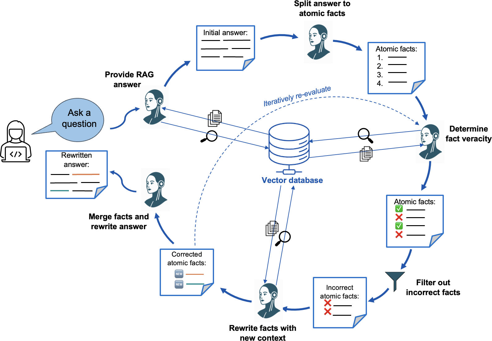

# 005｜从核查一句话，到找对今天的问题
## 一篇肿瘤 RAG 论文与三日 ICU 病例的对读

Juraj Vladika 等，*Improving Reliability and Explainability of Medical Question Answering Through Atomic Fact-Checking in Retrieval-Augmented Large Language Models: Creation and Validation Study*。原创方法与验证研究，发表于 *Journal of Medical Internet Research*，2026，28，e92090。期刊 2025 年影响因子 **8.2**；JCR 医学信息学 **Q1（4/54）**，卫生保健科学与服务 **Q1（8/194）**。阅读整理于 2026-11-26。[论文全文](https://www.jmir.org/2026/1/e92090/) · [期刊指标](https://www.jmir.org/about-journal/indexing-and-impact-factor)

### 一、先读两道题：医生交给模型的工作有什么不同？

**论文肿瘤讨论病例 ID 1。** 一名患者接受了前列腺癌根治术。病例把术前影像和活检、术后病理分期、切缘及淋巴结情况列在一起，最后问：“What further action is recommended?”（下一步建议采取什么措施？）这个问题需要专科判断：同一份输入里有术前、术后两套分期，读者要分清哪一套与当前决定有关。公开表中肿瘤讨论会的共识译意为：建议依据 PSA 的变化随访，也可考虑较早开始辅助放疗。输入含提问 **293 tokens**，这条共识 **48 tokens**。该病例公开的输出是专家参考答案，我们没有查到这一次 GPT‑4o 初答和修正稿的完整原文。[作者论文及数据来源，见 ID 1 的 case 与 consensus 两列](https://www.jmir.org/2026/1/e92090/)

**我们的 ICU 病例 F09。** 医生原题只有“护理要点”。模型另外收到 **3,805 tokens** 的患者资料与问题，其中含压缩摘要和连续三日日档。截止日前两日均有低氧及吸痰后改善的记录。以下按相对日期概述本项目病例。

这两天的记录说明，气道护理值得写，是因为相邻两日都有与吸痰有关的低氧记录。模型实际面对的是整份材料，提问没有替它圈出这两句。直答已经抓到了这一点，原答概括了连续两日的低氧事件及吸痰后的变化。静态组和动态组各自又添了哪些具体做法，放在第四节逐句核对。[项目实验设计与时间锚点说明](../../reports/compressed-20261120/checkpoints.md)

### 二、读图 1：作者怎样从一份回答追到一条证据？

**图 1. 原子事实核查流程架构示意图。** 原图取自 Vladika 等发表于 JMIR 的论文 Figure 1，保留英文图面。图注为中文翻译。[图源与原文](https://www.jmir.org/2026/1/e92090/) · [CC BY 4.0](https://creativecommons.org/licenses/by/4.0/)

沿着图读一遍：系统先按**整道问题**从肿瘤指南库取 7 个文本块，生成初答；再把答案拆成可分别核对的最小主张。此时检索单位变了，系统按**每一条主张**重新取 7 块，把患者题面也作为核查依据，判 TRUE 或 FALSE；对判错的主张尝试修正，再据此重写整份回答。举例来说，同一句里的治疗方式、疗程和适用条件可以分别核对。作者用人工评阅检查逐条判定是否正确，也比较核查前后整份回答是改善、退化还是无变化。肿瘤讨论组 40 例中，作者报告 20 例改善、3 例退化。[方法、结果及附录提示词](https://www.jmir.org/2026/1/e92090/)

对我们最有启发的是图的中段。遇到“每 4–6 小时监测气囊压力”，可以分别查“监测气囊压力”和“间隔为 4–6 小时”。论文允许核查器事后补检，这有助于找到支持或修正一句话的知识；我们还要保留**生成当时**的检索记录，才能回答原答中的频次在当时有无出处。论文所报 **Top‑1 为 75%、Top‑3 为 91.9%**，衡量最相关指南段落的排序命中情况；一句话里数字和条件是否都得到支持，是另一个判断。[论文 Explainability 小节](https://www.jmir.org/2026/1/e92090/)

### 三、154 与 5,105.5 tokens：这 33 倍里装了什么？

| 患者资料＋提问 | 例数 | 最短 | 中位数 | 最长 |
|---|---:|---:|---:|---:|
| 论文真实前列腺癌肿瘤讨论病例 | 40 | 48 | **154** | 308 |
| 我们的正式 ICU 病例 | 30 | 3,793 | **5,105.5** | 15,142 |

我们的输入中位数约为论文的 **33 倍**。多出来的内容有明确用途：昨天异常的指标，今天是否仍然异常？一次处置之前和之后的两次测量，各能支持哪句话？这里的日期和趋势本身就是任务的一部分。较长的输入提出了一个可以检验的问题：**关键数值明明已经出现在截止前资料中，模型是否仍会读错日期、混淆先后或漏掉病程转折？** 要把其中某种错误写成反复出现的现象，需要给出实际例数、核查分母和对应原句。要进一步归因于长度，还需要在保留关键事实的条件下做长短输入对照。

计数统一使用 o200k_base，仅计原语言的患者资料和提问，排除系统提示、专家答案和外部证据。论文库把指南按约 512 tokens 切块、相邻块重叠 100 tokens；这些片段属于额外知识输入。作者公开病例 CSV 有 80 条非空记录，附录 S10 将实际肿瘤讨论实验标为 40 例前列腺癌，故本表取 ID 1–40。我们取正式 30 例的冻结患者资料加医生原题。语言和资料重复程度也会影响 token 数。[作者附录表 S5、S10](https://github.com/sebischair/ImprovingReliabilityMedicalQA/blob/main/Supplementary_Materials-v3.pdf) · [正式 30 例实验说明](../../reports/compressed-20261120/README.md)

### 四、两个实测案例：一次查证据，一次查先后

**F09：更具体的护理建议，具体到了哪一步？** 三组收到相同的患者资料和原题。下表只摘与气道护理有关的答案，引用编号沿用原答。

| 回答条件 | 模型回答（直答为转述） | 对照原文后可以怎样判断 |
|---|---|---|
| 直答，0 条知识证据 | 概述连续两日与痰液相关的低氧及吸痰后改善 | 已经根据病例识别出连续两日的问题。查库组也写到气道管理时，应以此为比较起点。 |
| 一次拆解查库，10 条 | “严格执行吸痰前预充氧：通过手动呼吸给予高浓度氧（纯氧3-5分钟）” | 原答指向 E1。“吸痰前预充氧”有出处，相比直答补上了准备步骤。E1 分开写“手动呼吸，吸入高浓度氧”和“接受机械通气的患者，可通过吸入纯氧3～5 分钟达到预充氧的目的”。原答把方式、浓度和时长合写，具体操作只获部分支持。 |
| Agent-loop 动态补查，6 条 | “建议每4–6小时监测气囊压力，维持20–30 mmHg” | 这里只核“每4–6小时”。此前对读在本组实际入模的 6 条材料中未找到该间隔，原配对评阅恰因这个细节更具体而偏好动态组。这条偏好理由应复核；该频次在其他资料中的医学依据另行判断。 |

同一道题里，患者记录解释了**为什么应关注气道**，知识原文支持了**吸痰前的一项准备**，而另一个新增频次在本组材料中找不到依据。把这三个层次保留下来，才能看清知识库究竟改变了什么。[三组实验归档](../../reports/compressed-20261120/README.md)

**独立心梗交班复核 test4：两次血压都抄对，为什么仍要改一句话？** 这是后来构造的综合交班题，用来复核动态补查何时可以停止。以下为同一日上午、截止前的记录。该例单列，不计入上表正式 30 例的分母。

首次测量发生在躁动时，安静后复测的收缩压和舒张压均低于首次读数。A 条件的规划暂答读对了下降方向，最终解释却写成“血压回升”，并据此描述循环改善。B 条件的终答也用了“回升”。

**这处错误改变了对短时趋势的描述。** 核对后可以写“安静后复测血压较躁动时下降；仅凭这两次测量，无法判断休克已经纠正”。模型最终保留了后一层审慎判断，前一句关于回升及循环改善的理由需要改。一例中的两次运行能证实这个病例确实出现过方向反转，不能当成两名独立患者，也不能据此估计长病例出错率。[停查对照的实验结果与终答错误记录](../../reports/agent-loop-20261126/README.md)

### 五、我们的病例能多回答哪一个问题？

这篇论文给了我们一个值得沿用的办法：拿答案中一句医学判断，拆开核对，让医生能查到相应的指南段落。三日 ICU 病例可以把核对再往前移一步：当医生只问“护理要点”，模型有没有从截止前资料里选对今天值得写的事？这需要读患者记录；要知道外部知识补上了什么、把哪句话说得过满，则要读那次生成真正收到的证据。

实际验收时，可将一个观察写成两句。第一句交代**患者事实及时间**，例如“相邻两日均有吸痰相关低氧记录”；第二句交代**哪组新增了哪项判断、依据在何处**，例如“静态组增加吸痰前预充氧，本组 E1 支持该原则，具体方式和时长仅部分得到支持”。遇到时间错误，则直接并排显示两次测量与模型的方向词。这样医生既能识别一次真正的补充，也能指出一份总体看似合理的回答中究竟哪句话需要改。
