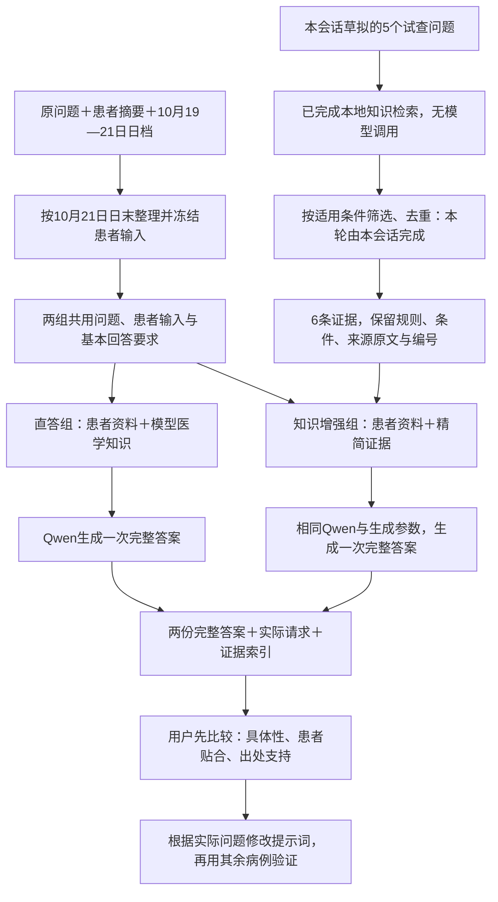

# T06两组试答：先看输入怎样变成答案

**当前知识增强组基线（2026-11-19 确认）**：后续试答沿用 [共同提示词 v3](common_system_v3.txt) 与 [增强附加提示词 v2](kb_addendum_v2.txt)。允许使用简洁表格，引用紧跟证据直接支持的主张。病例 3 的原始 C 组用这套提示词生成了三日趋势表，并在心电图建议旁标注了 [E1]。两次无表格输出保留作对照。

我们要先看一个具体变化：给模型相同的病例与问题，补入少量相关知识证据后，答案是否更具体、更贴合患者，也更容易检查依据。本轮先把输入和输出摊开，不设总分，也不提前认定增强组更好。

**网络问题已定位并恢复（2026-11-17）：** 初次请求默认读取Windows系统代理，返回HTTP 420；恢复上周Conda环境及`trust_env=False`直连后，同一请求返回HTTP 200。未改变系统代理、密钥或模型请求体。两组均已生成并收到stop及DONE；直答后半段转为无关抒情文字，增强组后半段出现计算机术语列表，均标为异常输出。首次增强流中断及恢复记录单独保留。

## 1. 本轮流程

本轮不运行多轮补查，不按每个子问题单独生成答案。后续可把“本会话草拟5个试查问题”替换为“一次模型拆解”；这一环尚未验证，不能在本轮结果里称为自动拆解的效果。

## 2. 固定了哪些输入

原问题保持原文：

> 基于患者从入科至今情况，结合当前检查等信息，给出今日病情状况？治疗方案如何修改？

用户已确认以**2026年10月21日23:59:59，Asia/Shanghai**为分析时点。这是新建的回顾性试答，原提问时间10:54不再作为本轮截止点。

患者输入约**6,102 token**；增强组增加约**998 token**的知识材料。这些是o200k_base本地估算，不是目标模型精确计费数。正式请求还包含提示词、问题和格式包装。

原9,029 token候选包含截至24日的摘要。整理时移除了后续摘要与混合后续日期的检查摘要；21日监测字段汇总到22日07:00，无法可靠分离，暂整段移出。三天其他日档栏目仍保留，检查数据仍可从日档读取。两组使用同一个整理版本，不用其他内容补足8k。这个取舍会影响答案可用细节，评阅时应一起考虑；输入并非三天所有原始资料完整。

摘要和归档中已有的判断性措辞原样保留，两组都能看到。这轮观察的是在现有建档之上增加知识的效果。

## 3. 模型实际收到什么

两组都是一个system消息、一个user消息。

|消息|直答组|知识增强组|
|---|---|---|
|system|共同回答要求＋直答补充要求|相同共同要求＋证据使用补充要求|
|user|样本号、截止时间、实验说明、原问题、完整固定患者输入|左侧全部相同，另加knowledge_evidence|

不把5个检索问题作为固定答案目录，也不把检索分数、路径节点、完整候选池或身份标识交给回答模型。

**共同提示词的核心：**先概括当前病情和三天重要变化，再按优先级说明维持或调整方向；重要判断连接患者事实；缺少关键条件时说明目前可判断什么、补什么会改变方案；区分执行、计划与建议。完整文本见文末。

**直答组补充：**结合患者资料和医学知识回答，不编造出处。

**增强组补充：**选择适用证据支持、细化或修正判断，在对应主张后标编号；保留条件、阈值、单位和例外。未覆盖处可继续医学分析，说明关键推断；不为了用完证据增加无关建议。

## 4. 本轮知识材料怎么选

已保存5个独立查询的真实检索结果，合计108条次、约11.6万字符，存在重复；这不意味着旧流程会全部输入模型，旧流程也有公共证据池与预算。本轮从中选6条，目标是先看精简材料的呈现效果。

|编号|保留主题|适用条件检查重点|
|---|---|---|
|K01|继发性腹膜炎治疗无效时感染源控制|术后持续症状及感染灶；不把检索结果直接当患者已形成脓肿|
|K02|气道湿化与管理|接受氧疗的患者|
|K03|人工气道梗阻处理|实际发生梗阻且处理未缓解的情形；不能把既往事件当现在仍在发生|
|K04|容量反应性指导液体治疗|有液体治疗需要、评估显示可能获益|
|K05|动脉乳酸动态监测|标本类型和时点对应|
|K06|严重感染患者血栓预防|需要结合患者出血风险等条件解释|

每条向模型提供知识单元内容、适用范围、完整关联证据片段和简短来源；重复的操作规则字段、内部ID和检索分数留在后台。完整关联片段避免只截半句丢掉例外。

肝移植、烧伤专用方案，以及与本题不匹配的消化道出血栓塞等条目未入选。K04、K06来自文件名标注2012 SSC的存量资料，本轮如实标注来源，不称为最新指南。筛选由本会话完成，未调用额外筛选模型；尚未由医生审查，也不是自动筛选流程的验收结果。药物肝肾安全性等问题未因此获得专门证据，不宣称6条覆盖原问题所有方面。

## 5. 生成参数和保存的输出

两组使用qwen3.8-27b，沿用用户本次.env采样参数：temperature=0.6、top_p=0.95、presence_penalty=1.03、frequency_penalty=1.0，流式返回。为这次试答显式设定enable_thinking=false、max_tokens=8192，并请求usage；不修改.env原值。与上周temperature=0等配置不同，本次只作组内比较。

每组计划生成1次，不挑选更好版本。由于temperature非零，单次差异包含生成波动；目前先看具体实例，不据此估计稳定增益。

每组保存：

- `messages.json`及`实际输入.md`：完整实际输入，方便阅读和逐字核对。
- `request.json`：最终发送体，不含Authorization或密钥。
- `response.sse`：实际返回流；`answer.md`：模型最终content，不作润色。
- `status.json`：结束原因、耗时、usage、哈希。finish_reason为length或缺结束标记时记为不完整，不冒充完整答案。

最终答案允许自然段或简洁表格，不要求模型照固定模板写。两组分别显示为“模型直答”和“知识增强”，方便第一轮检查，尚非盲评。

完整原文位于受控目录中直答的campus_direct_recovery/answer.md和增强的campus_direct_retry1/answer.md；另提供两组原始答案对照。传输完整仅表示返回结束，不能替代内容检查，本轮两组均已观察到跑题。

## 6. 你先看什么

第一步看输入：保留的患者资料是否足够表达本题，哪些移除内容值得从源记录补回；6条证据是否少而有用，有没有遗漏关键方向。

第二步看答案：具体圈出哪里更贴合患者、哪里只是套话、哪个建议增加了适用条件、哪个出处真正支持相邻判断。也记录两组共有的问题。先找可解释的差异，不以篇幅或引用数量判优。

这轮比较的是“模型直答”与“人工精简证据＋证据提示词”的整体变化，尚不能单独归因于提示词、证据压缩或自动拆解。下一轮若要判断提示词本身，固定同一证据包再比较提示词版本。

## 查看入口

- [两组输入输出索引](controlled_raw/two_arm_preview_v1/查看输入输出.md)
- [共同提示词v1](common_system_v1.txt)
- [直答组补充v1](direct_addendum_v1.txt)
- [知识增强组补充v1](kb_addendum_v1.txt)
- [拆解提示词草稿，未在本轮调用](decomposition_system_v0.txt)
- [输入整理清单](input_manifest.json)
- [证据及输入长度](preview_setup.json)

包含患者内容的全文、身份映射、实际请求均保存在Git忽略的controlled_raw目录。本文使用脱敏样本号；密钥仅在同目录被忽略的.env中。

## 本轮输出观察与下一步

直答模型usage为输入6,331、输出1,173 token；增强为输入7,191、输出3,433 token，均原样保存。首次增强流中断的部分输出也保留，不与最终重试结果拼接。本轮两组均后段跑题，不据此判断知识库是否提高质量。

本次采样为用户curl参数0.6/1.03/1.0（temperature/presence/frequency），上周为0/0/0。这是后续值得控制验证的差异，尚不能认定异常由该差异引起。若继续排查，优先固定本次输入和提示词，只恢复上周采样参数做小验证；不同时改提示词、证据和参数。网络直连设置保持已验证配置。

## 恢复上周采样参数的小验证

随后只对直答组复测一次。请求体逐字段对账仅temperature、presence_penalty、frequency_penalty由0.6/1.03/1.0改为0/0/0，问题、患者资料、提示词、模型及其他参数均相同。本次输出3,066字符、1,998 token，未见前述词语联想跑题；仍有日期及信息解释问题，不据此宣布医学正确。该结果支持优先恢复旧采样组合，尚不能区分3个参数各自影响。原.env未改。

[复测原文](controlled_raw/sampling_check_direct_v1/answer.md)；[参数对账](sampling_diagnostic.json)。
